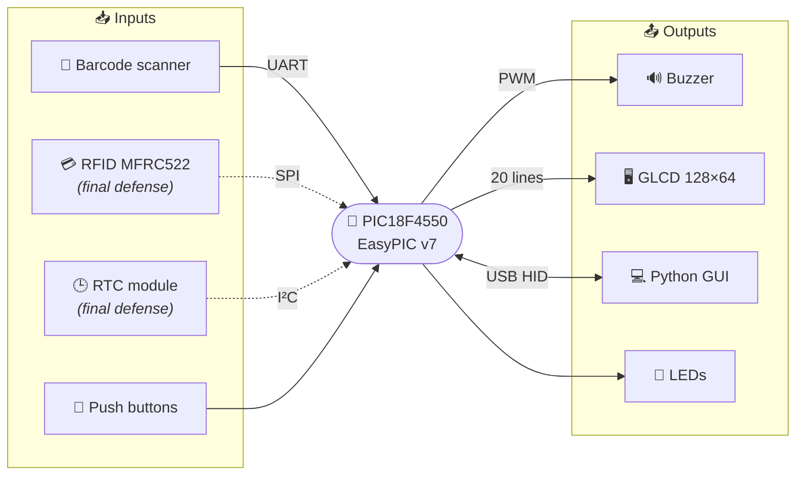
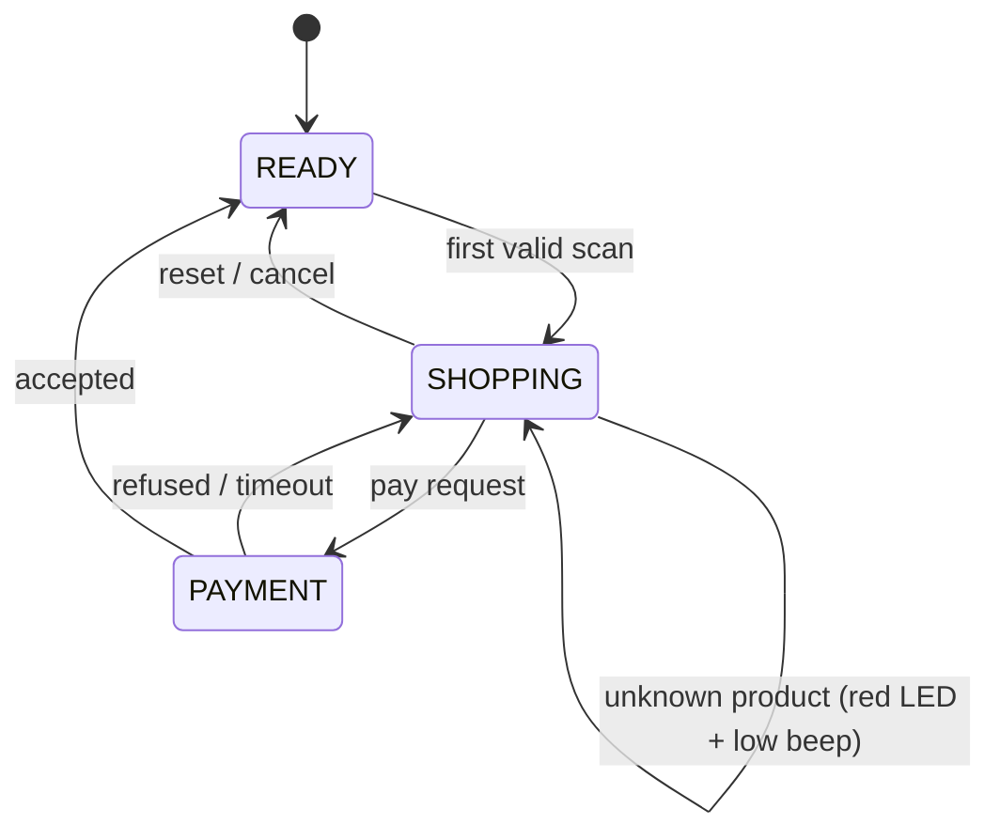

<div align="center">

# 🛒 PIC-MARKET

### Embedded Smart Checkout System

*Scan it. Bag it. Pay it, all on a PIC18F4550.*


</div>

---

## 📖 Table of contents

- [About the project](#-about-the-project)
- [First defense scope](#-first-defense-scope)
- [System architecture](#-system-architecture)
- [Hardware](#-hardware)
- [Software architecture](#-software-architecture)
- [PIC ↔ GUI protocol](#-pic--gui-protocol)
- [Repository structure](#-repository-structure)
- [Getting started](#-getting-started)
- [Demo scenario](#-demo-scenario)
- [Roadmap](#-roadmap)
- [AI usage statement](#-ai-usage-statement)
- [Team](#-team)

---

## 💡 About the project

**PIC-MARKET** recreates the main steps of a modern retail transaction on a small scale. A customer scans products with a barcode reader, adds loose items such as fruit or bread through a graphical interface, identifies with a loyalty card, and pays contactlessly. Prices and status are shown on a **GLCD** on the board, while a **Python GUI** on the laptop keeps the cart, the invoice and the purchase history.

The system is built around an **EasyPIC v7** board with a **PIC18F4550**, programmed in C with the **XC8** compiler, and talks to the laptop as a **USB Full-Speed HID** device.

---

## 🎯 First defense scope

For this first milestone we deliver a working, simplified version of the checkout focused on **product scanning** and **display**. RFID and RTC are designed into the architecture but not implemented yet.

| Feature | Status |
|---|:---:|
| Full KiCad schematic (every module broken down to its components, labelled blocks) | ✅ |
| Barcode reading over UART (9600 bps, CR-terminated, interrupt-driven) | ✅ |
| Product lookup, unknown products rejected | ✅ |
| Price displayed on the GLCD | ✅ |
| Green / red LED feedback | ✅ |
| Buzzer feedback (valid / unknown product) | ✅ |
| USB HID link between PIC and Python GUI | ✅ |
| Python GUI showing scanned items (name, unit price, quantity, subtotal, total) | ✅ |
| Loyalty card & contactless payment (RFID, SPI) | 🔜 Final defense |
| Date & time on GLCD and invoices (RTC, I²C) | 🔜 Final defense |
| Invoice generation, loyalty points, transaction history | 🔜 Final defense |

> ✏️ **Team note:** adjust the ✅ marks so they match exactly what works on demo day.

---

## 🧩 System architecture



Solid lines are implemented for the first defense; dashed lines come next.

---

## 🔌 Hardware

| Block | Interface | Role |
|---|---|---|
| **Waveshare barcode scanner** | UART · 9600 bps | Reads product barcodes, sends ASCII + CR |
| **MFRC522 RFID** | SPI | Loyalty card and contactless payment *(upcoming)* |
| **RTC module** | I²C | Timestamps for display and invoices *(upcoming)* |
| **Push buttons** | GPIO | Reset / cancel and local controls |
| **Buzzer** | PWM (CCP) | Audible feedback |
| **GLCD** | Parallel (20 lines) | Price and status display |
| **LEDs** | GPIO | Green = OK, red = error |
| **Laptop** | USB Full-Speed HID | Python GUI |

The complete schematic is in [`hardware/`](hardware/).

<!-- Add a screenshot of your KiCad schematic here -->
<!--  -->

---

## 🧠 Software architecture

The firmware runs as a **finite state machine**, with time-critical events (UART reception, USB, timers) handled by **interrupts**.



> ✏️ **Team note:** replace with your real states if they differ.

### Feedback signals

| Event | LED | Buzzer |
|---|---|---|
| ✅ Valid product | 🟢 Green · 2 s | 100 ms · 2.5 kHz |
| ❌ Unknown product | 🔴 Red · 2 s | 300 ms · 1.5 kHz |
| 💳 Payment accepted *(upcoming)* | 🟢 Green · 2 s | 2 × 200 ms · 3.5 kHz |
| 🚫 Payment refused *(upcoming)* | 🔴 Red · 2 s | 2 × 200 ms · 1 kHz |

All buzzer tones use a 50 % duty cycle.

---

## 📡 PIC ↔ GUI protocol

<!-- Describe your real frame format here. Example layout: -->

| Byte | Field | Description |
|---|---|---|
| 0 | `CMD` | Command / message type |
| 1 | `LEN` | Payload length |
| 2…n | `DATA` | Payload (barcode, price, status…) |

| Code | Direction | Meaning |
|---|---|---|
| `0x01` | PIC → PC | Barcode scanned |
| `0x02` | PC → PIC | Product info / price |
| `0x03` | PC → PIC | Unknown product |
| `…` | | |

---

## 📁 Repository structure

```text
PIC-MARKET/
├── firmware/          # C code for the PIC18F4550 (MPLAB X + XC8)
│   ├── main.c
│   ├── fsm.c / fsm.h
│   ├── uart.c / uart.h
│   ├── glcd.c / glcd.h
│   ├── buzzer.c / buzzer.h
│   └── usb/           # USB HID stack
├── gui/               # Python application
│   ├── main.py
│   ├── products.json
│   └── requirements.txt
├── hardware/          # KiCad project & schematic exports
├── docs/              # Slides, images, diagrams
└── README.md
```

---

## 🚀 Getting started

### Prerequisites

- MPLAB X IDE + **XC8** compiler
- EasyPIC v7 with a PIC18F4550 (and mikroProg or another programmer)
- Python 3.10+

### 1. Flash the firmware

```bash
# Open firmware/ in MPLAB X, build with XC8, then flash the PIC18F4550
```

### 2. Run the GUI

```bash
cd gui
pip install -r requirements.txt   # e.g. customtkinter, hidapi
python main.py
```

### 3. Connect

Plug the EasyPIC v7 USB port into the laptop. The GUI detects the HID device, and you can start scanning.

---

## 🎬 Demo scenario

1. **Start**: the GLCD shows the welcome screen and the GUI connects.
2. **Scan a known product**: green LED, short high beep, price on the GLCD, line added in the GUI.
3. **Scan it again**: its quantity goes up instead of creating a new line.
4. **Scan an unknown barcode**: red LED, long low beep, nothing added to the cart.
5. **Reset**: the transaction is cancelled and the system returns to its initial state.

---

## 🗺️ Roadmap

- [x] KiCad schematic
- [x] Barcode scanning over UART
- [x] GLCD price display
- [x] LED and buzzer feedback
- [x] Python GUI with cart
- [ ] RFID loyalty card (SPI)
- [ ] Contactless payment with 10 s timeout
- [ ] RTC date & time (I²C)
- [ ] Invoices, loyalty points and persistent history
- [ ] Robustness: anti double scan, empty cart, USB disconnection recovery
- [ ] Oscilloscope test & validation of the technical specifications

---

## 🤖 AI usage statement

> The project follows a **Level 2 – integration** AI policy. List precisely **where** and **how** AI was used.

| Where | Tool | How it was used |
|---|---|---|
| This README | Claude | Generated the README layout and structure from the project brief; content checked and completed by the team |
| *…* | *…* | *…* |

---

## 👥 Team

| Name | Role |
|---|---|
| *Member 1* | *Firmware* |
| *Member 2* | *Python GUI* |
| *Member 3* | *Hardware / KiCad* |

<div align="center">

---

Made with ☕ and a lot of oscilloscope probes at **ECE Paris**

*A smooth sea never made a skilled sailor.* ⛵

</div>
